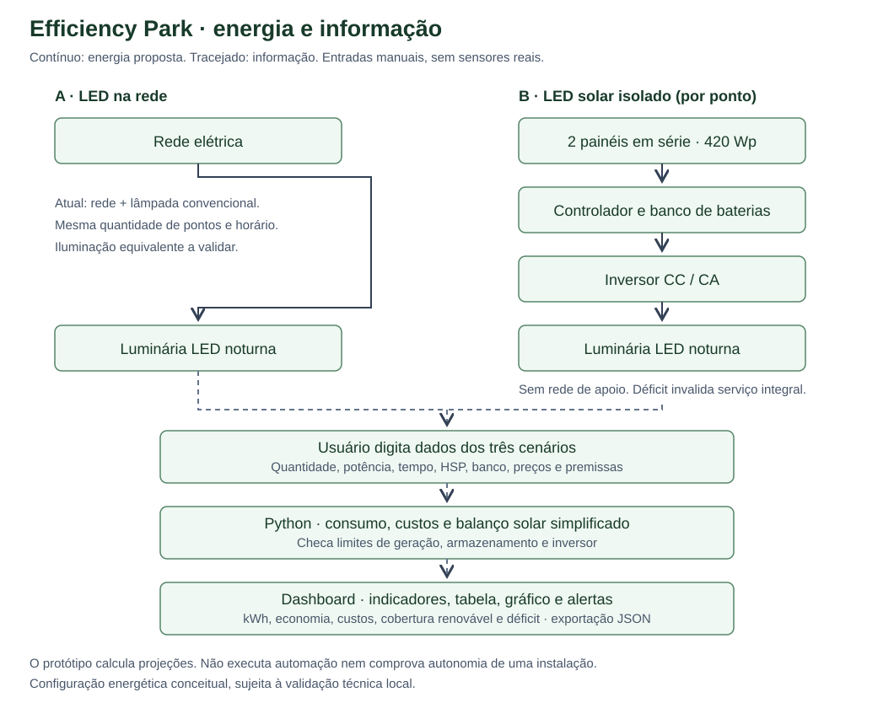

# Efficiency Park

Módulo energético do **Neighborhood Action Dashboard — CitizenTech**. Global Solution 2026.2 | Ciência da Computação | **Soluções em Energias Renováveis e Sustentáveis (SERS)**.

## Acesso rápido aos dados

**[Apresentação e animação — apresentacao.html](apresentacao.html)** · [Dashboard Python](app.py) · [Premissas editáveis e fontes](dados.json) · [Valores extraídos do HTML original](referencias/html_original_dados.json) · [Roteiro do vídeo](roteiro_video.md)

O dashboard agora parte dos **valores do HTML original**: 12 postes, lâmpada de sódio de 100 W + reator de 15 W, LED de 60 W, sensores, dimerização e três alternativas. O professor pode alterar os parâmetros pela barra lateral, observar o recálculo e restaurar os padrões com um botão.

Para usar apenas a apresentação, baixe o ZIP em **Code → Download ZIP**, extraia a pasta e abra `apresentacao.html` no navegador. O GitHub mostra o código do HTML; a cópia local executa os controles. Para alterar as premissas, use o Python conforme as instruções abaixo.

## Integrantes

| Nome | RM |
| --- | --- |
| Matheus Roberto | 575653 |
| Gustavo Oliveira Baptista | 575597 |
| Ana Luísa Santos | 574806 |

## Problema e solução

Uma praça comunitária precisa de iluminação noturna adequada, com menor desperdício e custos justificáveis. Os beneficiários são moradores, usuários do espaço e responsáveis pela manutenção. Este estudo considera uma **praça simulada de referência**; não houve levantamento de campo, instalação ou medição.

Comparamos a referência e três alternativas para a mesma necessidade de iluminação, condicionada à validação fotométrica:

| Código | Cenário |
| --- | --- |
| A0 | Lâmpadas de sódio e reatores ligados na rede, sem dimerização. |
| A1 | LED com sensores e dimerização, alimentado pela rede. |
| A2 | LED com sensores, painel e bateria por poste; sistema isolado. |
| A3 | A1 + painéis no quiosque, com troca de energia pela rede e crédito financeiro hipotético. |

**Estágio atual:** software de simulação funcional, com campos editáveis, cálculos, gráficos, indicadores, checagens, animação de presença, JSON e apresentação HTML. Sensores físicos, ESP32, comunicação e acionamento automático são a **arquitetura proposta**, ainda não implantada. O modelo estima o efeito energético da presença e da dimerização; a animação não mede movimento real nem determina a fração de presença dos cálculos.

## Rodar no Windows

Instale Python 3.11 ou superior compatível com a versão do Streamlit em `requirements.txt`. Baixe e extraia o repositório inteiro e abra o terminal na pasta que contém `app.py`. Mantenha todos os arquivos e subpastas juntos.

```powershell
py -m venv .venv
.\.venv\Scripts\python.exe -m pip install -r requirements.txt
.\.venv\Scripts\python.exe -m streamlit run app.py
```

Se o computador usa `python` em vez de `py`, substitua apenas o comando de criação do ambiente. Não é necessário ativar o ambiente virtual: os demais comandos já usam o executável da `.venv`.

## Rodar no macOS

No Terminal ou no terminal do VS Code, dentro da pasta extraída:

```bash
python3 -m venv .venv
source .venv/bin/activate
pip install -r requirements.txt
python -m streamlit run app.py
```

Abra a **Local URL** informada no terminal, normalmente `http://localhost:8501`. Mantenha o terminal aberto; Control+C encerra o painel. Para abrir em outro dia, execute somente o último comando. Não é necessário banco de dados, conta no Streamlit ou equipamento físico.

Se aparecer `Could not open requirements file`, confira se o terminal está na pasta correta e se o ZIP foi extraído. Para `No module named streamlit`, reinstale as dependências usando o Python da `.venv` e execute com esse mesmo Python.

## Testes que o professor pode fazer na interface

1. Abra o painel e confira o cenário padrão: **491,3 kWh** atuais e **177,6 kWh** com LED + sensores em 30 dias, redução de demanda de **63,9%**.
2. Altere **Quantidade de postes** de 12 para 24: a demanda e os equipamentos por poste dobram. A capacidade do quiosque é compartilhada e só muda se o campo de kWp for alterado.
3. Em **Sensores e dimerização**, altere a presença de 20% para 100%: a economia diminui, pois a iluminação fica mais tempo em potência total.
4. Em **Solar e bateria**, coloque HSP conservadora de A2 em zero: aparece déficit e os indicadores de economia operacional, retorno e benefício ambiental equivalente de A2 ficam indisponíveis.
5. Altere tarifa, crédito de A3, capacidades ou custos e observe os resultados. Geração FV e compra física da rede são mostradas separadamente.
6. Clique em **Restaurar valores do HTML original** para recuperar o exemplo.
7. Salve o JSON e use **Carregar uma simulação salva → Aplicar arquivo** para recuperar exatamente as entradas. O JSON deve pertencer à versão atual do modelo (versão 2).
8. Baixe a **apresentação HTML desta simulação**. Ela preserva o estilo e a animação do HTML original, mas recebe os resultados recalculados pelo Python.

As alterações são locais à sessão e não sobrescrevem `dados.json` nem o GitHub. Uma nova sessão começa com os padrões; para persistir as entradas, salve o JSON.

## Valores de referência e sua origem

O arquivo `referencias/html_original_dados.json` contém os dados extraídos do primeiro HTML fornecido pela equipe. O arquivo `dados.json` contém as entradas editáveis, integrantes, fontes e justificativas. Os resultados não são armazenados como constantes do dashboard: são recalculados em `calculos.py`.

| Parâmetro inicial | Valor | Fundamentação e limite |
| --- | --- | --- |
| Postes / noite / período | 12 / 11,8667 h / 30 dias | Premissas do HTML original, não medições nem duração regulamentar afirmada pelo projeto. |
| Referência convencional | 100 W + 15 W de reator | Categoria de sódio; 15 W são estimativa do estudo. Fluxo nominal de referência 10.600 lm. |
| LED | 60 W / 9.000 lm | Categoria existente com especificação declarada pelo vendedor em F4; não comprova equivalência fotométrica ou dimerização do produto. Validar driver, óptica e iluminação mínima. |
| Uso intenso | 5 h/noite | Hipótese de luz total antes do modo de presença. Limitada automaticamente ao total da noite. |
| Espera / presença na madrugada | 30% / 20% | Hipóteses editáveis. Potência é aproximada como proporcional ao nível de dimerização. |
| IoT | 0,5 W por poste, 24 h/dia | Carga auxiliar hipotética, incluída na demanda das alternativas. |
| Tarifa | R$ 0,43416/kWh | TUSD + TE B4a Enel SP: (259,83 + 174,33) / 1.000, tabela consultada em 09/11/2026. Sem adicionais; confirmar enquadramento. |
| FV A2 / bateria | 200 Wp / 1,28 kWh por ponto | Capacidade de ensaio do HTML. Não define módulos, tensão, controlador, conversores ou produto comercial compatível. |
| HSP conservadora / média | 3,8 / 4,9 h/dia | Condições de ensaio, não média meteorológica comprovada de uma praça ou de junho. |
| Rendimento FV / descarga / saída do banco | 75% / 90% / 95% | Hipóteses de balanço e armazenamento, não limites certificados do fabricante. |
| FV no quiosque | 1,6 kWp | Capacidade compartilhada, hipotética e editável. |
| Crédito unitário de A3 | R$ 0,356211/kWh | Hipótese financeira herdada do HTML. Não é cálculo regulatório nem garantia de faturamento ou aprovação da compensação. |
| A1 / A2 instalados | R$ 925 / R$ 4.600 por ponto | Estimativas do HTML, com equipamentos e instalação no escopo considerado. Sem orçamento comercial local. |
| FV A3 instalado | R$ 5.500/kWp | Estimativa do HTML: 1,6 × 5.500 = R$ 8.800 adicionais a A1. |
| Manutenção anual | Atual 37,50; A1 10; A2 60 R$/ponto; FV 93,75 R$/kWp | Hipóteses do estudo, não histórico de manutenção. |
| Reposição A2 | R$ 1.000/ponto nos anos 4 e 8 do ensaio de 10 anos | Cronograma orçamentário escolhido para reproduzir os R$ 24.000 do HTML; não é vida útil certificada. Evento exatamente no fim do horizonte não é incluído. |
| Fator CO₂ | 0,0545 kg/kWh | Preservado do HTML original, com referência indicada de 2024. Não representa um fator atual de 2026; consultar MCTI e ajustar conforme o objetivo. |

As referências de tarifa e características **não validam os preços completos, rendimentos, HSP, presença ou cronograma de reposições**. Todos esses itens permanecem identificados como estimativas. A documentação do MME fundamenta os conceitos, não os coeficientes do ensaio.

## Cálculos

```text
h_madrugada = h_noite - mínimo(h_uso_intenso, h_noite)
h_equivalentes = h_intenso + h_madrugada × [presença + (1−presença) × espera]
E_atual_dia = postes × (W_lâmpada + W_reator) × h_noite / 1000
E_alternativas_dia = postes × [W_LED × h_equivalentes + W_IoT × h_IoT] / 1000
E_período = E_dia × dias_selecionados
E_anual = E_dia × 365
Redução_demanda = (E_atual − E_alternativas) / E_atual × 100
FV_quiosque_ano = kWp × HSP_média × rendimento_global × 365
Crédito_A3 = mínimo(FV_ano, demanda_ano) × crédito_unitário
Crédito_A3 é limitado ao custo variável de energia do modelo
Operação_ano = custo variável de energia_ano + manutenção_ano
Operação_período = Operação_ano × dias/365
Economia_operacional = operação_atual − operação_alternativa
Payback_simples = investimento / economia anual recorrente
Custo_horizonte = investimento + operação_ano × anos + reposições previstas
```

Presença e espera entram como frações entre 0 e 1. Quando o consumo atual é zero, percentuais relativos usam 0 por convenção. Se não há economia anual positiva, o payback fica indisponível. O **retorno simples não inclui reposições nem desconto**; o custo no horizonte as inclui. Sem inflação, juros, degradação ou orçamento executivo. O ano tem 365 dias, portanto 30 dias não são automaticamente 1/12 da análise anual.

### A2: solar isolado

A demanda é a mesma de A1. A energia solar atendida por dia é o menor valor entre demanda, geração útil e capacidade útil do banco. A geração usa `Wp × HSP × rendimento global / 1000`; o banco usa `kWh nominais × descarga × aproveitamento de saída`. Não se reaplica o aproveitamento de saída à geração, cujo rendimento global já inclui as perdas até a carga.

No padrão, cada ponto demanda **0,49328088 kWh/dia**, gera **0,570 kWh/dia** no ensaio conservador e tem **1,0944 kWh úteis** de banco. A autonomia teórica é **2,2186 noites**, partindo de banco cheio. Isso não valida sequência climática, iluminação ou compatibilidade elétrica.

Quando há déficit, não se apresenta o menor gasto por falta de iluminação como economia para o mesmo serviço. A2 continua sem compra da rede; o déficit aparece separadamente. Seus indicadores equivalentes de economia operacional, retorno e CO₂ ficam indisponíveis. A comparação de custos precisa ser interpretada com esse alerta.

### A3: rede e FV do quiosque

A iluminação continua comprando energia da rede à noite. O FV gera de dia e um **crédito unitário hipotético** reduz o custo variável estimado. A geração não é subtraída da compra física noturna exibida no painel. O crédito é limitado à demanda anual e ao custo da energia, sem venda de excedentes neste modelo.

O percentual de FV local é um **balanço anual**, não fornecimento direto noturno e não a participação de renováveis da rede brasileira. Rede sem FV local aparece com 0% de geração local, sem afirmar que o SIN não tem fontes renováveis.

O indicador de CO₂ usa o fator adotado para estimar a operação ou o saldo energético anual. No caso de A3, a dedução da geração é uma aproximação de balanço, **não um inventário certificado, crédito de carbono ou análise de ciclo de vida**. A emissão associada à importação física da rede também permanece disponível nos resultados JSON.

## Resultados que reproduzem o HTML original

Referência de 30 dias; custos e retornos condicionados às premissas:

| Indicador | A0 | A1 | A2 | A3 |
| --- | ---: | ---: | ---: | ---: |
| Demanda no período (kWh) | 491,28 | 177,58 | 177,58 | 177,58 |
| Compra física da rede (kWh) | 491,28 | 177,58 | 0,00 | 177,58 |
| Custo variável de energia (R$) | 213,29 | 77,10 | 0,00 | 14,26 |
| Economia operacional (R$/período) | 0,00 | 163,32 | 191,10 | 213,83 |
| FV local no balanço (%) | 0,00 | 0,00 | 100,00 | 99,33 |
| Investimento (R$) | 0,00 | 11.100,00 | 55.200,00 | 19.900,00 |
| Payback simples (anos) | — | 5,59 | 23,74 | 7,65 |
| Custo estimado em 10 anos (R$) | 30.450,86 | 21.680,33 | 86.400,00 | 24.335,33 |

A redução da **demanda** das três alternativas é 63,85%; os 100% de rede evitada de A2 indicam troca de fonte e não eliminação do consumo. Na referência, A1 tem o menor custo total no horizonte; A3 é uma proposta com geração FV local e investimento adicional. A decisão depende das prioridades e da viabilidade, não de uma recomendação universal.

## Indicadores e diagrama

Há indicadores de consumo (kWh/período), redução de demanda (%), economia operacional (R$/período), FV local no balanço (%), déficit (kWh), CO₂ potencial do balanço (kg/ano), tempo em espera (h/dia), investimento e retorno simples. Todos derivam das entradas e das fórmulas do módulo.



As fontes e cargas são propostas de implantação. O MVP usa **entrada manual → cálculos Python → dashboard e apresentação**. A animação representa presença; a fração de presença dos cálculos é informada pelo usuário.

## Séries simuladas e animação

O perfil de potência da noite usa os horários informados; o gráfico representa só as luminárias, enquanto a carga IoT é contabilizada separadamente na energia. A série diária usa as variações ilustrativas do HTML original, escaladas às entradas atuais. Ela não é a base do dia médio usado nos indicadores.

A série de bateria começa cheia, considera geração diurna e depois o consumo noturno; mostra a carga após a noite. Ela pode diferir do gráfico de carga do primeiro HTML por explicitar essa ordem temporal. O balanço de projeto de A2 não recebe energia gratuita de uma carga inicial. Ambos são modelos simplificados, sem comprovação de autonomia real.

A apresentação preserva a animação original das lâmpadas reagindo à passagem de uma pessoa simulada. A arquitetura física de sensores e dimerização segue planejada; o cálculo estima o comportamento pela presença e potência de espera informadas no painel. Os percentuais da animação são ilustrativos e não substituem medições.

## Apresentação e exportação

O botão do dashboard gera um HTML autossuficiente com **as entradas atuais e os resultados do mesmo `calculos.py`**. Abra o arquivo baixado no navegador, use as setas para trocar de cena e F para tela cheia. A apresentação tem nove cenas, roteiro e cronômetro. O botão de dashboard local depende do Streamlit iniciado no mesmo computador.

Para regenerar a versão de referência do repositório após editar os dados ou o template:

```bash
python apresentacao.py
```

No Mac, use `python3` ou `.venv/bin/python`. O modelo atual é a versão 2; arquivos JSON da antiga comparação de dois cenários não são compatíveis. Nenhum resultado do HTML original é usado como constante para impedir o recálculo: o arquivo extraído serve à rastreabilidade e aos testes de reprodução.

## Arquivos e testes

| Arquivo | Função |
| --- | --- |
| `app.py` | Interface editável, controles de restauração e importação, indicadores e downloads. |
| `calculos.py` | Consumo, dimerização, solar, finanças e séries simuladas. |
| `dados.json` | Padrões, integrantes, fontes e justificativas. |
| `referencias/html_original_dados.json` | Registro dos dados do primeiro HTML. |
| `apresentacao.py` | Geração da apresentação com resultados atuais. |
| `apresentacao_template.html` | Visual e animação do HTML original, com explicações de escopo. |
| `apresentacao.html` | Versão offline gerada com os padrões. |
| `diagrama.svg` | Arquitetura conceitual e fluxo de dados do MVP. |
| `tests/` | Reprodução do HTML, alterações de parâmetros, limites físicos e interface. |
| `roteiro_video.md` / `entrega_modelo.txt` | Apoio à apresentação e entrega no Portal. |

Com as dependências instaladas:

```bash
python -m unittest discover -s tests -v
```

## Benefícios, limites e entrega

O benefício esperado é reduzir desperdícios e orientar uma decisão sustentável, mantendo iluminação adequada. Custos, autonomia, impacto ambiental e conforto não foram medidos em campo. É preciso validar iluminação mínima na dimerização, produtos e tensões, recurso solar, medição/faturamento, manutenção e descarte de lâmpadas, baterias e painéis. Não há garantia de aumento de segurança ou impacto zero.

O professor pede vídeo técnico não listado no YouTube, com no máximo três minutos, mostrando problema, análise e alternativas, diagrama, indicadores, benefícios e limitações. O roteiro é apoio, não substitui a gravação. Preencha o link real em `entrega_modelo.txt`, teste ambos os links e envie **apenas o .txt** no Portal, conforme o prazo da disciplina.

## Referências

Os links completos e o uso de cada fonte estão em [dados.json](dados.json) e no painel: HTML original do grupo, Enel SP (tarifa), Signify (categoria de sódio), Ledstronic (categoria LED), MCTI/SIRENE (metodologia de CO₂) e MME (conceitos de sistemas solares). As consultas de características não constituem aprovação dos produtos ou orçamento da implantação.
